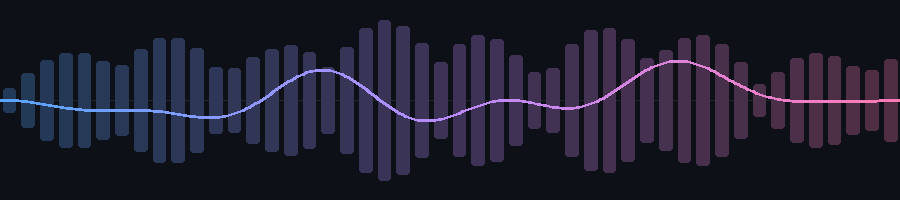

  

### About Me
 
- **Name:** Pietro Zanella
- **Role:** Software Developer @ Sky Italia (Online Video Platform team)
- **Focus:** Video player SDK for web and HbbTV, adaptive streaming, low-latency playback
- **Education:** Bachelor's degree in Audio-visual techniques and media production, Conservatorio A. Vivaldi (Alessandria)
- **Background:** Sound technologies background, now building video playback and streaming tools
- **Community:** Participant in the MonteVideo Tech Summer Project and member of the Video Dev community
- ⚡ **Currently exploring:** Media over QUIC, client-side media processing in the browser (WASM, WebGPU, WebCodecs)

### 🚀 Open Source Projects
 
| Project | What it does |
|---|---|
| [**moq-lab**](https://github.com/pzanella/moq-lab) | Local Media over QUIC (MoQ) sandbox with server-side, client-side and server-guided ad insertion |
| [**vertix**](https://github.com/pzanella/vertix) | 16:9 → 9:16 video reframing in the browser, Rust/WASM face detection, nothing uploaded |
| [**sluice**](https://github.com/pzanella/sluice) | DevTools extension to monitor, test and replay WebTransport and MoQ traffic, no proxy needed |
 
> I like moving media processing to the browser: client-side first, browser-native APIs, nothing uploaded when it doesn't have to be.
 
### 🌐 Connect with Me
 

 
### 👨‍💻 Tech Stack
 
**Languages & Web**
 

 
**Video & Streaming**
 

 
**Testing & Tooling**
 

 
**Cloud & CI/CD**
 

 
### 📊 GitHub Stats
 

  
  

 